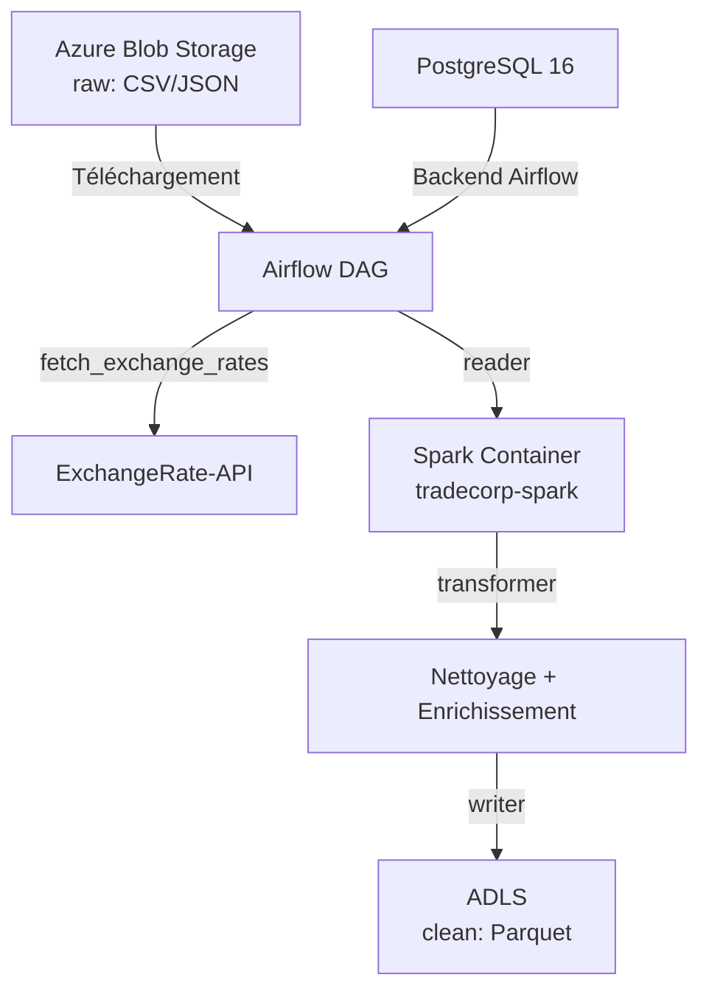
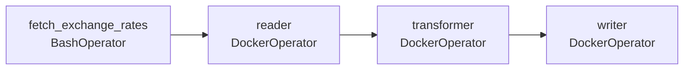

# PROJET TradeCorp Data Platform
*Pipeline ETL avec Apache Spark, Docker, Apache Airflow et Azure Data Lake Storage*

[](https://www.python.org/downloads/)
[](https://airflow.apache.org/)
[](https://spark.apache.org/)
[](https://www.postgresql.org/)
[](https://www.docker.com/)
[](https://azure.microsoft.com/fr-fr/products/storage/blobs/)
[](https://azure.microsoft.com/fr-fr/products/storage/data-lake-storage/)

## 🎯 Contexte
Pipeline ETL automatisée pour nettoyer, enrichir et stocker les données commerciales de TradeCorp. Les données **CSV et JSON** brutes (incluant les fichiers de référence pour l'enrichissement) sont téléchargées depuis **Azure Blob Storage**, transformées avec **PySpark** (nettoyage, déduplication, calculs, conversions de devises), puis stockées au format **Parquet** dans **ADLS**.

## 🏗️ Architecture


## 🛠️ Stack Technique
- **Orchestration**: Apache Airflow 2.8.4 (Python 3.11) + Docker Compose
- **ETL**: Apache Spark (PySpark) avec Hadoop Azure 3.3.4
- **Stockage**: Azure Data Lake Storage Gen2
- **Base de données**: PostgreSQL 16 (backend pour Airflow)
- **Langage**: Python 3.11
- **Outils**: Jupyter Notebooks, azure-storage-blob, python-dotenv, requests, pytest

## 📁 Structure du Projet
```
/SPARK
├── src/                          # Code source (pipeline, reader, transformer, writer, utils, enrichment, fetch_exchange_rates)
├── dags/                         # DAGs Airflow
│   └── tradecorp_pipeline.py     # DAG principal (fetch_exchange_rates → reader → transformer → writer)
├── data/                         # Données locales et fichiers de référence
│   └── reference/                # Fichiers de référence (country_currency.csv, exchange_rates.json)
│   └── src/                      # Fichiers sources (country_currency.csv)
├── notebooks/                    # Notebooks Jupyter pour exploration et tests
├── tests/                        # Tests unitaires (pytest)
│   ├── run_tests.py
│   └── test_transformers.py
├── Dockerfile.spark              # Image Spark
├── Dockerfile.airflow            # Image Airflow 2.8.4 + Python 3.11
├── docker-compose.yml
├── requirements.txt
└── .env
```

## Fonctionnalités

### Pipeline ETL
- **Pipeline**: Script principal (`pipeline.py`) orchestrant le flux ETL complet avec logging détaillé (4 étapes : téléchargement → DataFrames → enrichissement → écriture)
- **Reader**: Téléchargement des **CSV et JSON** depuis ADLS (incluant les fichiers dans les sous-dossiers comme `reference/`) et création de DataFrames Spark
- **Transformer**: Nettoyage (trim, déduplication, cast, suppression des lignes nulles), enrichissement (jointures, calculs comme `sous_total`)
- **Writer**: Écriture des données nettoyées vers ADLS au format **Parquet**
- **Utils**: Fonctions utilitaires pour Azure (connexion, upload/download), Spark (session, types) et transformations génériques (trim, renommage, cast)

### Enrichissement des Données
- **Conversions de devises**: Ajout de la colonne `sous_total_local` via jointure avec les fichiers de référence
- **Fetch des taux de change**: Récupération automatique des taux depuis **ExchangeRate-API** et upload vers ADLS

### Tests Unitaires
- **pytest** : Tests complets pour `clean_orders`, `add_sous_total`, `clean_customers`, `add_currency_column`

## ✈️ Orchestration avec Apache Airflow

### Configuration
- **Version**: Apache Airflow 2.8.4 avec Python 3.11
- **DAG**: `tradecorp_etl_pipeline`
- **Fréquence**: Tous les jours à 6h UTC (`0 6 * * *`)
- **Options**:
  - `catchup=False` (pas de rattrapage des exécutions manquantes)
  - `retries=1` (1 tentative de réessai)
  - `retry_delay=5min` (délai avant réessai)

### Schéma du DAG


## Prérequis
- Docker et Docker Compose
- Compte Azure avec ADLS Gen2
- Fichier `.env` avec les credentials Azure :
  ```ini
  AZURE_STORAGE=<nom-du-storage>
  AZURE_KEY=<clé-d'accès>
  ```
- Accès internet pour le fetch des taux de change (API ExchangeRate-API)

## Installation
1. Cloner le projet et accéder au dossier
2. Créer `.env` avec `AZURE_STORAGE` et `AZURE_KEY`
3. Lancer les services : `docker-compose up -d --build`

Les services seront accessibles sur :
- **Jupyter Notebook**: http://localhost:8888
- **PostgreSQL**: `localhost:5434` (user: `admin`, password: `admin`, db: `tradecorp`)
- **Airflow**: http://localhost:8080 (user: `admin`, password: `admin`)

## Utilisation

La pipeline est **orchestrée via Apache Airflow** (voir [section dédiée](#-orchestration-avec-apache-airflow)).

### Exécution manuelle (pour tests/débogage)
```bash
# Exécuter le pipeline complet
docker exec tradecorp_spark spark-submit /home/jovyan/src/pipeline.py

# Exécuter les tests unitaires
docker exec tradecorp_spark python /home/jovyan/tests/run_tests.py

# Uploader le fichier de mapping pays → devise
docker exec tradecorp_spark python /home/jovyan/src/upload_country_currency.py
```

## Configuration Azure

### Stockage ADLS
- **Conteneur `raw`** :
  - Fichiers CSV bruts (`categories.csv`, `customers.csv`, `orders.csv`, etc.)
  - Sous-dossier **`reference/`** contenant :
    - `country_currency.csv` (mapping pays → devise)
    - `exchange_rates.json` (taux de change USD → toutes devises)
- **Conteneur `clean`** :
  - Fichiers Parquet enrichis (ex: `orders_enriched`)

### Credentials
- Stockés dans `.env` (à la racine du projet)

## Auteurs
TheRealRPI - Data Engineer Consultant pour TradeCorp International

## License
Projet académique - Simplon.co

## 📝 Exemple de Logs Airflow

### Tâche fetch_exchange_rates
```
[2026-09-08, 14:05:30 CEST] {subprocess.py:93} INFO - 2026-09-08 12:05:30,803 INFO fetch_exchange_rates: Transformation terminee; 166 devises.
```

### Tâche writer
```
[2026-09-08, 13:51:51 CEST] {docker.py:429} INFO - 2026-09-08 11:51:51,616 INFO __main__: DataFrame enriched.parquet écrit avec succès
```

### Options du DAG
```python
start_date=datetime(2026, 9, 1),  # date à partir de laquelle il "existe"
catchup=False,  # ne pas rattraper le passé
```
> Le `catchup=False` indique à Airflow de ne pas rattraper les exécutions de tâches pour les dates manquantes entre aujourd'hui et le `start_date`.

